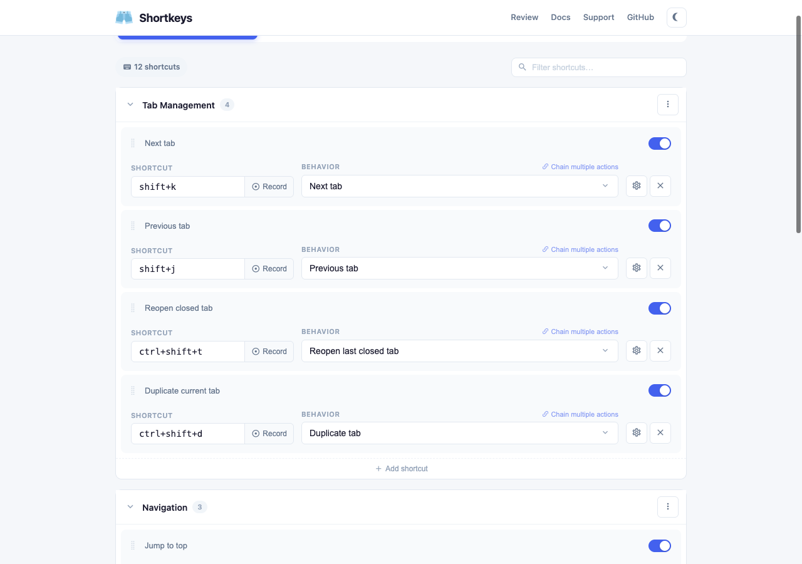
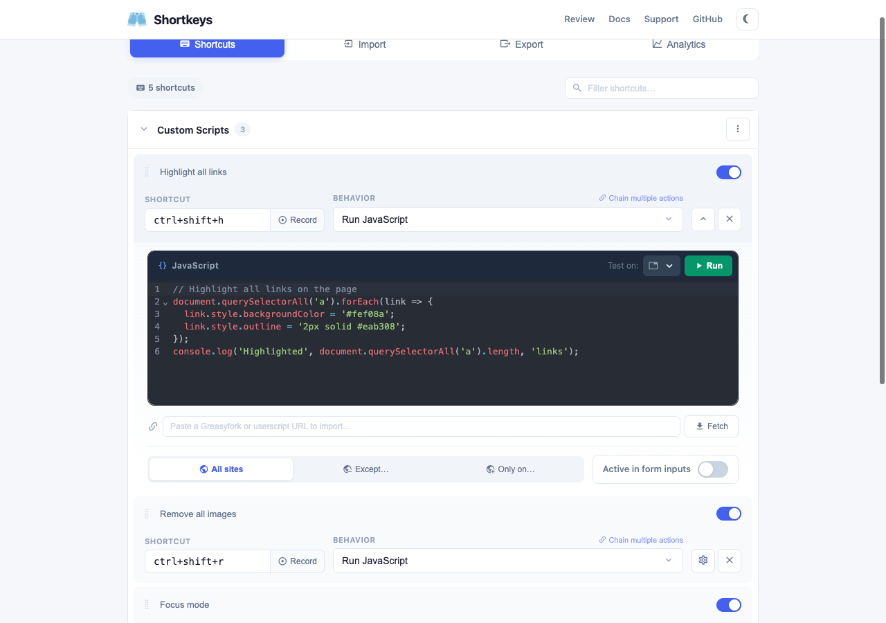
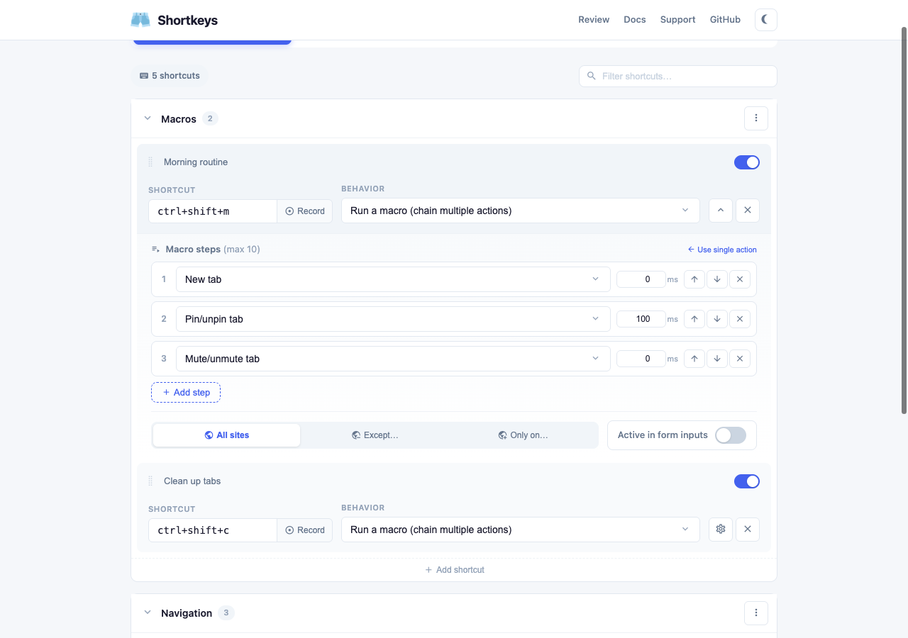
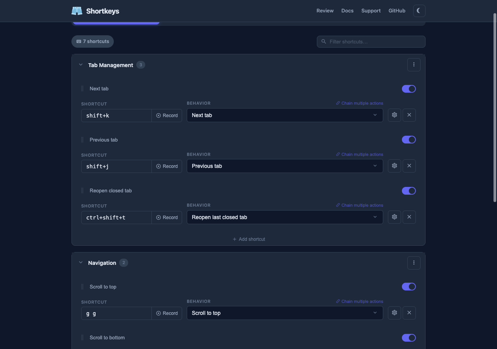

<p align="center">
  
</p>

<h1 align="center">Shortkeys</h1>

<p align="center">
  <strong>Custom keyboard shortcuts for your browser</strong><br>
  A browser extension for Chrome, Edge, and Opera with 200,000+ Chrome users. Firefox distribution is currently blocked.
</p>

<p align="center">
  <a href="https://chromewebstore.google.com/detail/shortkeys-custom-keyboard/logpjaacgmcbpdkdchjiaagddngobkck">Chrome Web Store</a> · <a href="https://github.com/crittermike/shortkeys/issues/864">Firefox status</a> · <a href="https://shortkeys.app">Website</a> · <a href="https://github.com/crittermike/shortkeys/issues">Issues</a>
</p>

<br>

<p align="center">
  
</p>

## Features

- ⚡ **125+ built-in actions** across 11 categories: scrolling, tabs, navigation, video controls, search, bookmarks, windows, zooming, page tools, page scripts, and more
- 🔍 **Command palette** - search saved shortcuts and run unassigned, zero-config actions without creating shortcuts. Quick-add opens settings when an action needs parameters.
- 📦 **9 curated shortcut packs** - one-click install for Vim, Emacs, YouTube, Productivity, Developer, Reading, Tab Manager, Keyboard Power, and Media Control
- ☁️ **Cloud sync** with automatic local fallback when data exceeds sync quota
- 📁 **Groups** - organize shortcuts into collapsible, renamable sections with bulk enable/disable
- 🔗 **Macro chaining** - chain multiple actions into a single shortcut, with separate URLs, text, and other settings for each step
- 🌐 **Site filtering** - all sites, blocklist, or allowlist per shortcut
- 🎬 **Live reload** - shortcuts update in all tabs instantly, no page refresh needed
- 🔗 **Shareable links** - generate a URL to share shortcuts or groups with anyone
- ⌨️ **Shortcut recorder** with multi-key sequence support (e.g. `g i`, `g h`)
- ⚠️ **Conflict detection** - platform-aware warnings for browser default clashes
- 🌙 **Dark mode** following system preference
- 📜 **Userscript import** from Greasyfork and OpenUserJS
- 🧙 **Guided onboarding** wizard for new users
- ↩️ **Undo/redo** in the settings page

<details>
<summary><strong>More screenshots</strong></summary>

### Custom JavaScript editor



### Macro chaining



### Dark mode



</details>

## Install

<table>
  <tr>
    <td align="center">
      <a href="https://chromewebstore.google.com/detail/shortkeys-custom-keyboard/logpjaacgmcbpdkdchjiaagddngobkck">
        <br>
        <strong>Chrome</strong>
      </a>
    </td>
    <td align="center">
      <a href="https://github.com/crittermike/shortkeys/issues/864">
        <br>
        <strong>Firefox status</strong>
      </a>
    </td>
    <td align="center">
      <a href="https://chromewebstore.google.com/detail/shortkeys-custom-keyboard/logpjaacgmcbpdkdchjiaagddngobkck">
        <br>
        <strong>Edge</strong>
      </a>
    </td>
    <td align="center">
      <a href="https://addons.opera.com/extensions/details/shortkeys/">
        <br>
        <strong>Opera</strong>
      </a>
    </td>
  </tr>
</table>

Edge users can install Shortkeys from the Chrome Web Store; it isn't listed on Edge Add-ons.

Firefox v5.0.1 was rejected by Mozilla for remote code execution and missing data-transmission consent. The AMO API currently lists only v2.0.20 (2017), and users report installation failures ([#864](https://github.com/crittermike/shortkeys/issues/864), [#982](https://github.com/crittermike/shortkeys/issues/982)). A successful source build is not a signed, approved Firefox release.

The Firefox source build targets desktop Firefox 153+ using Manifest V3. Custom JavaScript, JavaScript macros, and bookmarklets use Firefox's native user-script API: enable the optional permission, review and install each script, and reinstall after editing its code or website scope. Removing a script disables execution without deleting its editable code. Remote userscript URL loading is unavailable in Firefox. Optional data transmission requires Firefox's built-in consent and stops when that consent is revoked.

Firefox upgrades from v4.0.2 also read the legacy `localStorage.shortkeys` format when no newer shortcuts are saved. The original data is kept, and scripts still require explicit installation. If an earlier v5 upgrade already saved an empty list, existing v5 settings take precedence; recover the legacy JSON through the extension's developer tools rather than uninstalling the extension (which removes its data).

For an affected profile, open `about:debugging#/runtime/this-firefox`, find Shortkeys, click **Inspect**, and use the **Console** to run `copy(JSON.stringify(JSON.parse(localStorage.getItem('shortkeys')).keys, null, 2))`. Save the copied JSON as a backup, then paste it into Shortkeys' **Import** tab. If the command reports an error, stop rather than clearing any data. After importing, enable custom JavaScript and review and install each script in its shortcut settings.

Or build from source for development:

```bash
npm install
npm run build          # Chrome → .output/chrome-mv3/
npm run build:firefox  # Firefox 153+ → .output/firefox-mv3/
```

## Development

```bash
npm run dev            # Chrome dev mode with hot reload
npm run dev:firefox    # Firefox dev mode
npm run typecheck      # TypeScript and Vue checks
npm test               # Run all tests (722 tests across 25 files)
npm run test:watch     # Watch mode
npm run test:coverage  # With coverage report
```

## Project structure

```
src/
├── entrypoints/
│   ├── background.ts        # Service worker: messaging, action dispatch, storage sync
│   ├── content.ts           # Content script: Mousetrap key bindings, cheat sheet, dark mode
│   ├── options/             # Options page (Vue 3 SPA)
│   └── popup/               # Command palette popup
├── actions/                 # Action handlers and helpers
├── components/              # Vue components (CodeEditor, SearchSelect, ShortcutRecorder)
├── composables/             # Vue composables (useShortcuts)
├── packs/                   # 9 curated shortcut pack collections
└── utils/                   # Storage, URL matching, conflict detection, JS snippets

site/                        # shortkeys.app (Astro SSG, deployed to Netlify)
tests/                       # 722 tests across 25 files
marketing/                   # Store listing copy, screenshot plans, promo assets
```

## Tech stack

- **WXT** - Vite-based browser extension framework
- **Vue 3** - Composition API with `<script setup>`
- **TypeScript** throughout
- **Vitest** - 722 tests across 25 files
- **Mousetrap** - keyboard shortcut detection
- **CodeMirror 6** - JavaScript editor with syntax highlighting
- **Astro** - community website (shortkeys.app)

## Contributing

Pull requests are welcome. Please ensure all tests pass (`npm test`) before submitting. For bugs and feature requests, open a [GitHub issue](https://github.com/crittermike/shortkeys/issues).

Use Node 22, the version used in CI. Release preparation and browser signing requirements are documented in [RELEASING.md](RELEASING.md).

## Support

Shortkeys is free and open source. If you find it useful, consider supporting development:

- ⭐ [Star this repo](https://github.com/crittermike/shortkeys)
- 💛 [Sponsor on GitHub](https://github.com/sponsors/crittermike)
- ☕ [Buy me a coffee](https://buymeacoffee.com/crittermike)
- 📝 [Leave a review](https://chromewebstore.google.com/detail/shortkeys-custom-keyboard/logpjaacgmcbpdkdchjiaagddngobkck/reviews)

## Credits and license

Icon by [Freepik](https://www.flaticon.com/authors/freepik) from [Flaticon](https://www.flaticon.com/).

Licensed under the [MIT License](LICENSE.md).
